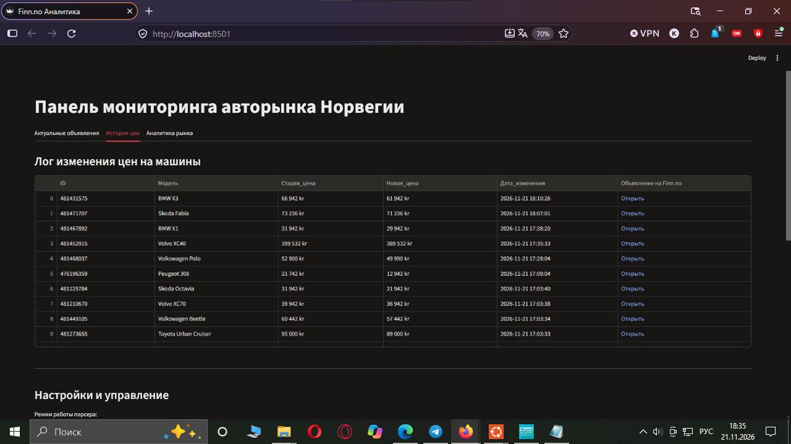
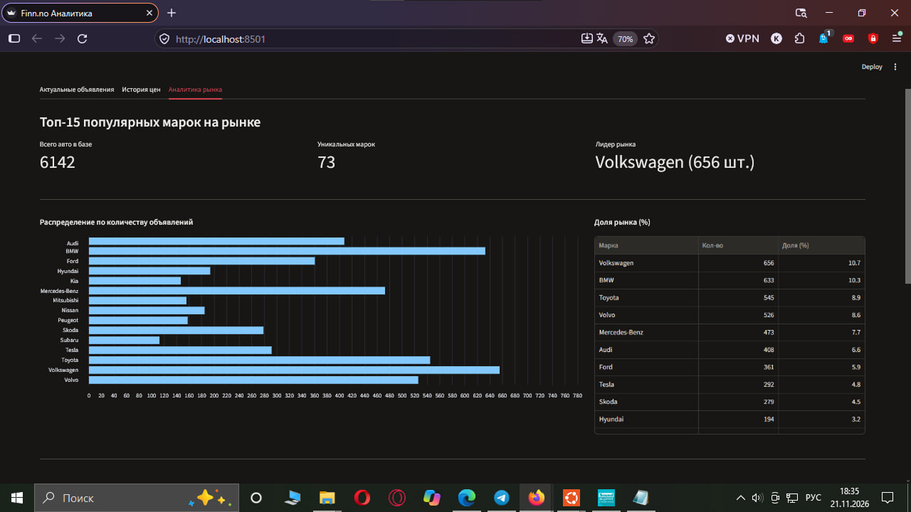
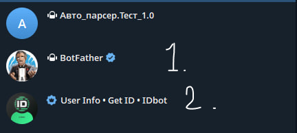
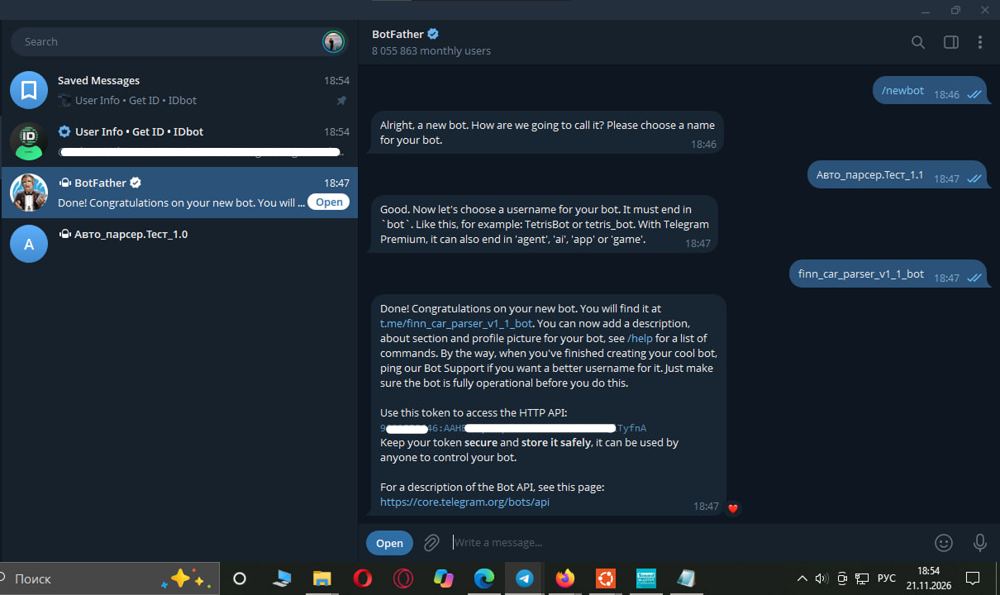
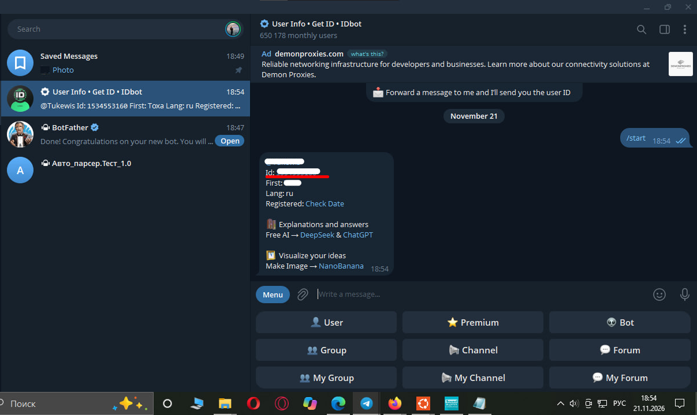
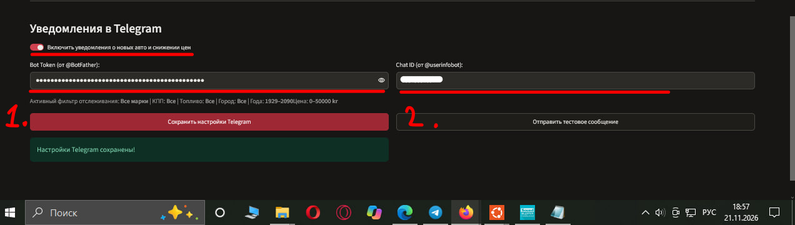
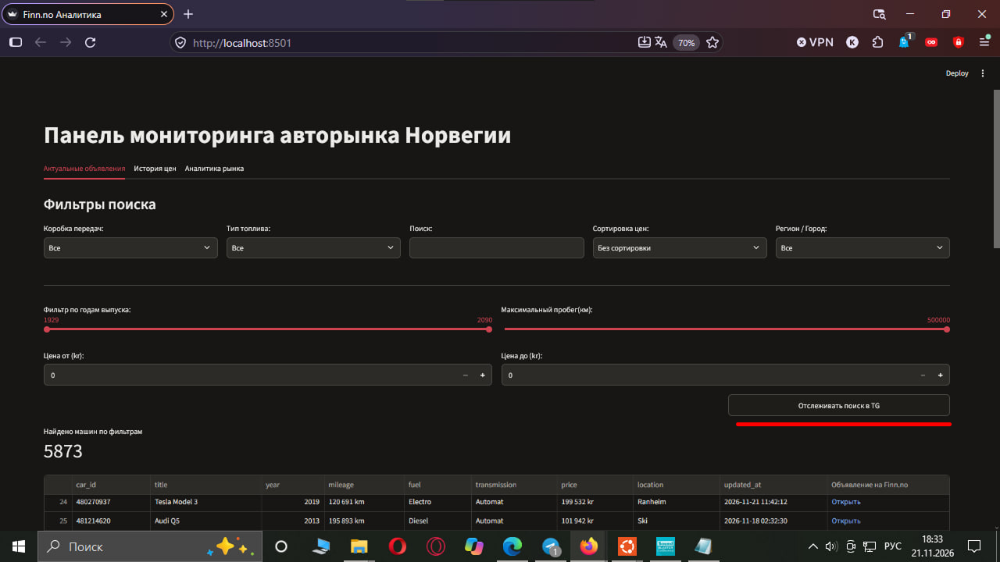
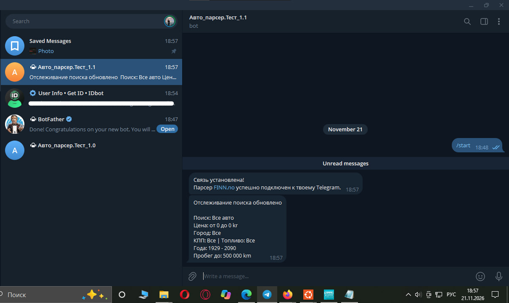

#Finn.no Car Market Analytics & Telegram Notifier

Локальный парсер и веб-панель аналитики авторынка Норвегии (Finn.no) на базе **Playwright**, **SQLite** и **Streamlit** с умными 
Telegram-уведомлениями о новых объявлениях и снижении цен.


---

## 1. Что он делает

* **Собирает и хранит базу объявлений:** парсит страницы Finn.no через Playwright и сохраняет данные в локальную БД SQLite (`database/cars.db`).
* **Следит за изменением цен:** фиксирует историю снижения и повышения стоимости каждого автомобиля (`old_price` → `new_price`) на отдельной вкладке.



* **Фильтрует и сортирует в реальном времени:** поиск по марке/модели, региону, типу КПП, топливу, диапазону годов выпуска,
* максимальному пробегу и вилке цен (**от / до** в NOK).
* **Строит аналитику рынка:** показывает топ-15 популярных марок и их долю среди собранных объявлений.



* **Работает в двух режимах:**
  * *Ручной запуск* — разовый прогон выбранного количества страниц прямо из веб-интерфейса.
  * *Автоматический режим* — фоновый планировщик (`auto_runner.py`), который запускает парсинг по таймеру.
* **Присылает сводки в Telegram без спама:** позволяет привязать текущие фильтры поиска одной кнопкой и отправляет
* **одно сводное сообщение** со ссылками за каждый цикл проверки (даже если нашлось 30–50 новых машин).

---

## 2. Как его установить

### Шаг 1. Клонируйте репозиторий
```bash
git clone https://github.com/Toxa1527/finn_car_market_analytics.git
cd finn_car_market_analytics
```

### Шаг 2. Создайте виртуальное окружение и установите зависимости
```bash
python3 -m venv .venv
source .venv/bin/activate  # Для Linux / macOS / WSL
# .venv\Scripts\activate   # Для Windows

pip install -r requirements.txt
playwright install chromium
```

### Шаг 3. Запустите проект
```bash
python3 start.py
```
После запуска веб-панель откроется в браузере по адресу: `http://localhost:8501`.

---

## 3. Как его настроить (Telegram-уведомления)

1. **Найдите двух официальных ботов в Telegram:**
   * `1.` **@BotFather** — для создания вашего бота и получения токена.
   * `2.` **@userinfobot** (`User Info • Get ID • IDbot`) — для получения вашего числового Chat ID.



2. **Создайте своего бота в @BotFather:**
   * Отправьте команду `/newbot`, придумайте имя и юзернейм бота (должен заканчиваться на `bot`).
   * Скопируйте выданный **Bot Token**.
   * Перейдите по ссылке `t.me/ваш_бот` и обязательно нажмите **Start** (`/start`), иначе бот не сможет писать вам первым.



3. **Узнайте свой Chat ID:**
   * Откройте диалог с `@userinfobot`, нажмите **Start** и скопируйте цифры из строки **`Id:`**.



4. **Подключите бота в веб-панели:**
   * Прокрутите главную страницу вниз до раздела **«Уведомления в Telegram»**.
   * Активируйте переключатель уведомлений, вставьте **Bot Token** и **Chat ID**.
   * Нажмите **`1.` «Сохранить настройки Telegram»**, затем **`2.` «Отправить тестовое сообщение»**.



5. **Привяжите фильтры поиска:**
   * На вкладке **«Актуальные объявления»** задайте нужные параметры (марка, КПП, год, пробег, цена от/до) и нажмите **«Отслеживать поиск в TG»**.



   * Бот сразу пришлёт подтверждение активных фильтров в Telegram и начнёт отправлять сводки по новым объявлениям.



---

## 4. Общение...

Всем привет! Я начинающий программист, учусь писать на Python в Neovim, и это мой первый полноценный проект. За конструктивную критику и советы в Issues 
буду очень благодарен.

И так, с чего начать...
Пожалуй, расскажу о главных граблях, на которые я наступил в процессе. В первой версии я недооценил сложность 
проектирования нормальной базы данных - с автоудалением неактуальных объявлений, историей цен, удобным редактированием и добавлением новых параметров. 
Из-за того, что я не продумал архитектуру БД заранее, в версии `v1.1` её пришлось переписывать почти с нуля. 
Также интересной задачей оказалась борьба со спамом в Telegram: когда парсер находил сразу 30–50 машин по фильтрам, он засыпал 
личку отдельными сообщениями — пришлось переделать логику на сбор очереди за цикл и отправку одной компактной сводки.

**Что я планирую делать дальше?**
Для начала я беру небольшую паузу. Да, сразу после первого проекта 🙂 
Но не для отдыха, а для изучения сложных для меня тем: тяжелее всего мне дались работа с асинхронностью 
(`asyncio` + Playwright) и проектирование баз данных. Также хочется в целом подтянуть базу программирования. 
Поэтому, прежде чем масштабировать этот проект или браться за следующий, лучше немного подучиться.

Этот проект я планирую развивать и дальше, хоть и не так активно. Мои планы по нему:
1. Перенос парсера на удалённый сервер (VPS) для круглосуточной работы.
2. Добавление новых категорий парсинга на Finn.no (работа, недвижимость и т.д.).
3. Подключение других площадок и сайтов.

За это я возьмусь после 1–2 месяцев обучения и практики на других мини-проектах, так что промежутки между обновлениями станут больше. 
Спасибо всем, кто заглянул!

---

# 🇬🇧 English Version

## Finn.no Car Market Analytics & Telegram Notifier

A local scraper and web analytics dashboard for the Norwegian car market (Finn.no) built with **Playwright**, **SQLite**, and **Streamlit**, featuring smart Telegram notifications for new listings and price drops.


---

### 1. What It Does

* **Collects and stores car listings:** scrapes Finn.no pages using Playwright and saves the data into a local SQLite database (`database/cars.db`).
* **Tracks price changes:** logs price drops and increases for every vehicle (`old_price` → `new_price`) in a dedicated tab.


* **Real-time filtering and sorting:** filter by make/model, region, transmission, fuel type, production year range, maximum mileage, and price range (**min / max** in NOK).
* **Market analytics:** displays the top 15 most popular car brands and their market share among scraped listings.


* **Two operating modes:**
  * *Manual run* — single scrape of a chosen number of pages directly from the web UI.
  * *Automatic mode* — background scheduler (`auto_runner.py`) that runs scraping on a timer.
* **Anti-spam Telegram digests:** bind your current search filters in one click and receive **a single summary message** with clickable links per scraping cycle (even if 30–50 new cars match).

---

### 2. Installation

#### Step 1. Clone the repository
```bash
git clone https://github.com/Toxa1527/finn_car_market_analytics.git
cd finn_car_market_analytics
```

#### Step 2. Create a virtual environment and install dependencies
```bash
python3 -m venv .venv
source .venv/bin/activate  # For Linux / macOS / WSL
# .venv\Scripts\activate   # For Windows

pip install -r requirements.txt
playwright install chromium
```

#### Step 3. Run the application
```bash
python3 start.py
```
Once started, the web dashboard will open in your browser at `http://localhost:8501`.

---

### 3. Configuration (Telegram Notifications)

1. **Find two official bots on Telegram:**
   * `1.` **@BotFather** — to create your bot and get its API token.
   * `2.` **@userinfobot** (`User Info • Get ID • IDbot`) — to get your numeric Chat ID.


2. **Create your bot via @BotFather:**
   * Send `/newbot`, choose a display name and a username (must end with `bot`).
   * Copy the **Bot Token**.
   * Open `t.me/your_bot` and press **Start** (`/start`), otherwise the bot cannot message you first.


3. **Get your Chat ID:**
   * Open `@userinfobot`, press **Start**, and copy the digits from the **`Id:`** line.


4. **Connect the bot in the web dashboard:**
   * Scroll down to the **«Уведомления в Telegram» (Telegram Notifications)** section.
   * Enable the toggle, paste your **Bot Token** and **Chat ID**.
   * Click **`1.` Save Telegram Settings**, then **`2.` Send Test Message**.


5. **Bind your search filters:**
   * In the **«Актуальные объявления» (Active Listings)** tab, set your desired filters (brand, transmission, year, mileage, min/max price) and click **«Отслеживать поиск в TG» (Track search in TG)**.


   * The bot will immediately confirm your active filters and start sending digests for matching listings.


---

### 4. A Few Words from the Author...

Hi everyone! I'm a beginner developer learning Python in Neovim, and this is my first full-fledged project. Any constructive feedback or tips in Issues are greatly appreciated.

To be honest, I underestimated the complexity of designing a solid database schema early on — with auto-cleanup of outdated listings, price history tracking, easy editing, and adding new parameters. Because I didn't plan the DB architecture ahead in v1.0, I had to rebuild it almost from scratch in `v1.1`. Another fun challenge was solving Telegram notification spam: when the scraper found 30–50 matching cars at once, it flooded the chat with individual messages, so I reworked it into a per-cycle queue that sends a single clean digest.

**What's next?**
First, I'm taking a short break from active feature development — not to rest, but to study the topics I struggled with the most: asynchronous programming (`asyncio` + Playwright) and database design, as well as strengthening my core programming fundamentals.

I do plan to keep developing this project, just at a slower pace:
1. Deploying the scraper to a remote VPS for 24/7 operation.
2. Adding new Finn.no categories (jobs, real estate, etc.).
3. Expanding support to other websites.

I'll return to these features after 1–2 months of study and building smaller practice projects, so updates will be less frequent. Thanks for checking it out!

